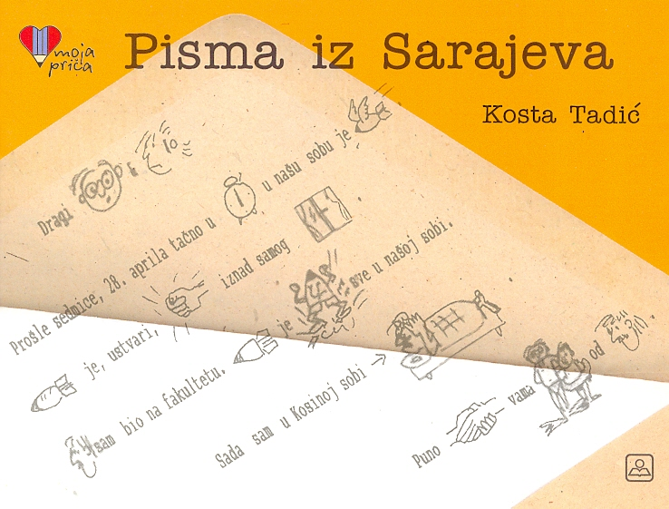
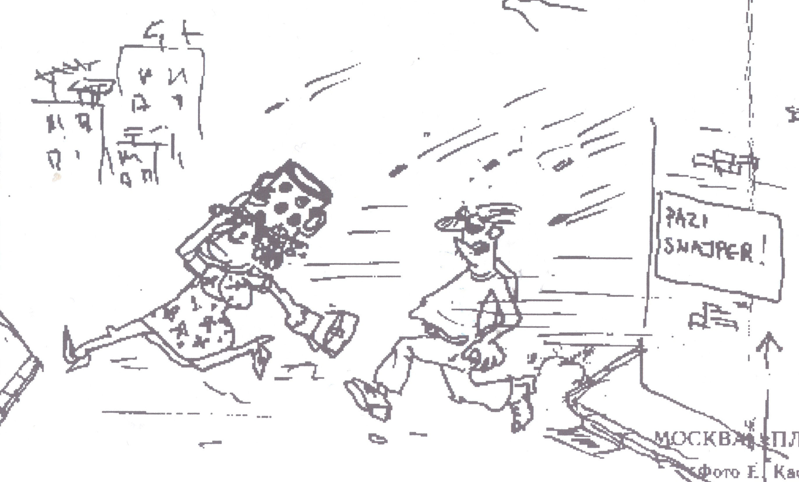
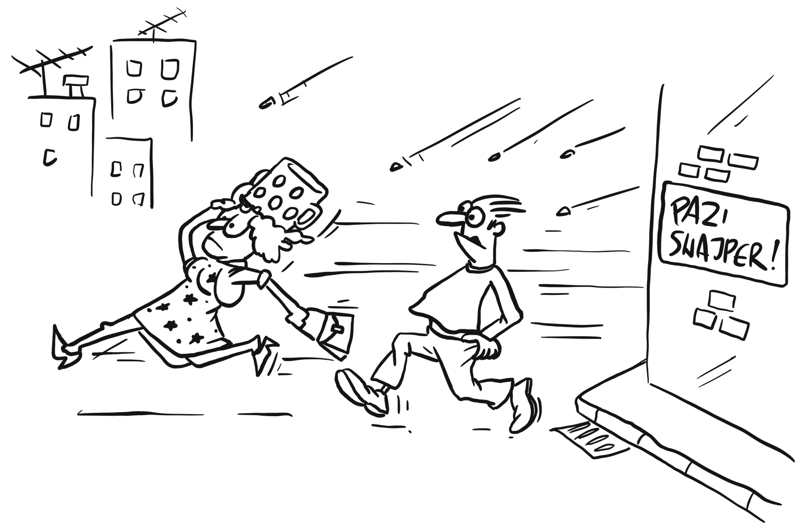

# 关于这本书

在1990年代，在波斯尼亚战争期间中，我们的父亲留在萨拉热窝市不能离开，而我的母亲，我的兄弟科斯塔和我逃到了塞尔维亚。 尽管困难重重，我们父亲还是给我们寄来了一些富有幽默的，积极的，充满图画的信件。

十年后，教科书出版社出版了一本书，其中包括我父亲精选的原始信件以及科斯塔在笔记本中写的回信。

这些信讲述了一个战争中的稍微不同而乐观的故事。

## 关于网站

创建该网站是因为我们想与所有人分享这个故事。

很难如实将这种形式的书上传到网站上。 我已尽力而为，但我仍然建议您在稍大的屏幕上而非手机上看《寄自萨拉热窝的信》。

同时非常感谢我的同事Felipe和Ana，他们将网站翻译成巴西葡萄牙语。

根据[CC BY-NC 4.0](https://creativecommons.org/licenses/by-nc/4.0/)许可，所有网站内容和代码均可在[GitHub](https://github.com/Stanko/letters-from-sarajevo)上获得。

## 图纸

不幸的是，原始信已随时间的流逝而被丢失了，只有其他数字版本的扫描但其质量很差。 因此，我们要非常感谢我的朋友[伊凡（Ivan Nedeljkovic）](https://www.instagram.com/sun_day_sign/)，他根据原图重新绘制了所有图纸，并将其数字化。

结果是惊人的，并且在下面您可以看到原始图纸之一和伊凡（Ivan）版本的比较。

  

  

  

  

现在，如果您想帮助将该书翻译成另一种语言或提出建议，请在GitHub上创建一个新的[Issue](https://github.com/Stanko/letters-from-sarajevo/issues)，以实现此目的。

感谢您的关注！

  斯坦科·塔迪奇（Stanko Tadić） 
  贝尔格莱德，2020年

